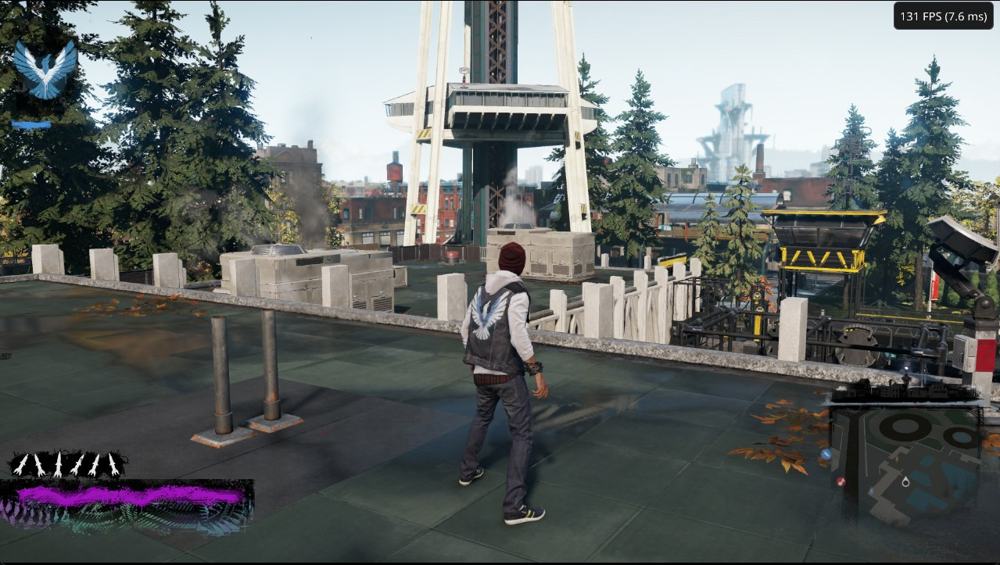
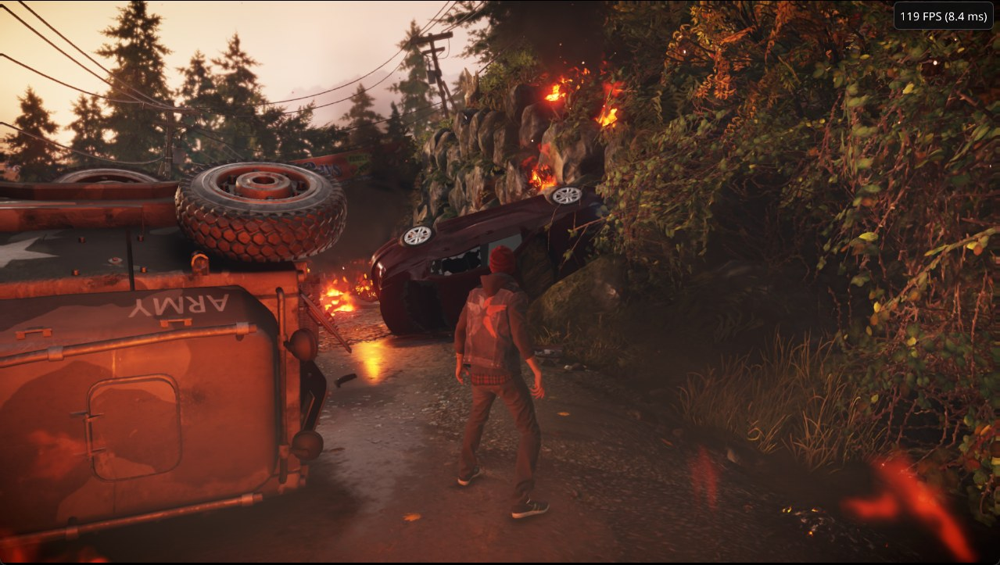
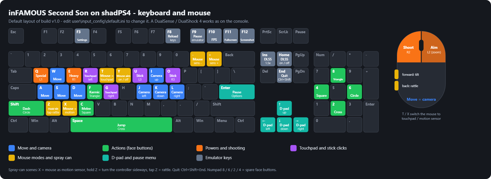

<!--
SPDX-FileCopyrightText: 2026 axylpup
SPDX-License-Identifier: GPL-2.0-or-later

The front page of github.com/axylpup/shadPS4 (shown from .github/README.md on the default branch, second-son).
GitHub shows .github/README.md before the root README.md, so upstream's README.md stays untouched.
-->

# inFAMOUS Second Son on PC

**A build of the [shadPS4](https://github.com/shadps4-emu/shadPS4) PlayStation 4 emulator, tuned for one game.** 
High frame rates, DLSS, real mouse aiming and a full keyboard layout, on Windows.

### [Download the latest build](https://github.com/axylpup/shadPS4/releases/latest)

Windows 10 / 11, one zip of about 75 MB. **You need your own copy of the game** - no game files are included.

Seattle rooftop on the test PC (i5-13600K + RTX 4070 Ti SUPER, 1080p). The counter shows that moment.

> Unofficial and experimental. Not affiliated with Sony Interactive Entertainment, Sucker Punch Productions or the
> shadPS4 team. Tested with the EU version (CUSA00004, update 1.07); the US version (CUSA00223) gets the same
> settings - reports welcome.

## Highlights

- **High frame rates:** on the test PC the open-world city benchmark runs at about 140 FPS (1% lows about 134) and
  the heaviest rooftop view at about 110 FPS (your screen shows at most its refresh rate). **One PC only** - as a very
  rough guide, the same PC limited to fewer CPU cores gave about 95 FPS (6 cores), 60 FPS (4 cores / 8 threads) and
  44 FPS (4 small efficiency cores). Treat these as estimates.
- **DLSS 4.5 (NVIDIA RTX):** upscales the game's 1080p to your 1440p / 4K screen (DLAA on 1080p screens), the HUD
  stays sharp. Bring your own NVIDIA files - 2 minutes, see below.
- **Real 1:1 mouse aiming** - the mouse moves the camera directly; left click shoots, right click aims.
- **Full keyboard + mouse layout**, including the spray-can (motion sensor) and touchpad parts.
- **Keyboard / mouse button icons** in the game's prompts - they switch to PlayStation buttons when you pick up a
  controller.
- **Fixes:** settings stay after a restart, the Load menu's "No" works, TVs in the city play, unplugging a controller
  hands control to the keyboard, controller-speaker sounds (ringtone, rattle) turned down to 25%.
- **Shader cache included** with a progress screen on the first start - far less first-time stutter.
- Sharper water reflections.

## Getting started

1. Download the zip from the [latest release](https://github.com/axylpup/shadPS4/releases/latest) and unzip it
   anywhere.
2. Run `shadPS4.exe` and pick your game folder (the one with `eboot.bin`). It remembers it.
3. The first start prepares shaders (one time, with a progress screen). Then play.

A DualSense / DualShock 4 works as on the console. All keys, the special sections (T = touchpad, X = motion sensor),
changing settings and troubleshooting are in the README inside the zip; `shadps4-flags-user-EXAMPLES.txt` lists the
settings players usually want.

**Updating:** unzip the new version over your old folder and replace the files. Saves, settings, keys, DLSS files and
your own `shadps4-flags-user.txt` stay. The first start prepares shaders once more.

## Keyboard and mouse

## DLSS (optional)

NVIDIA's files are not included (licence). Download **Streamline SDK 2.14.16** from
<https://github.com/NVIDIA-RTX/Streamline/releases> - exactly that version - and copy these five files from its
`bin\x64` folder (not `development`) into the `dlss` folder next to `shadPS4.exe`:

`sl.interposer.dll`, `sl.common.dll`, `sl.dlss.dll`, `sl.pcl.dll`, `nvngx_dlss.dll`

Start the game: DLSS turns on by itself. **Home** switches it on / off to compare. Without the files the game uses
its own anti-aliasing.

## Requirements

- Windows 10 / 11 64-bit, a Vulkan 1.3 graphics card (12 GB video memory recommended; 8 GB runs since 1.0.2), a fast
  6+ core CPU.
- DLSS: an NVIDIA RTX card (20 series or newer) and a recent driver.
- Tested only on Windows 11 + RTX 4070 Ti SUPER + i5-13600K. Other hardware should work (every new feature has a
  fallback) but is untested - reports welcome.

## Known issues

- Touchpad prompts and the controller picture in the Options screen still show the PlayStation controller.
- A few particle effects (smoke, fire) can flicker in places.
- With DLSS on, menus look a little less smooth around the edges; the F12 screenshot shows the HUD on black (use
  Alt+F12).
- Some heavy views (for example the first karma choice) sometimes run at about half their usual frame rate;
  reloading usually brings it back.

What changed in each version is on the [Releases](https://github.com/axylpup/shadPS4/releases) page.

## Found a problem?

[Open an issue](https://github.com/axylpup/shadPS4/issues/new/choose) and attach `user\log\shad_log.txt` (and
`user\log\fatal.txt` after a crash). The form asks for your graphics card, CPU and what you were doing. This page is
for this build only - problems with other games or the official shadPS4 builds belong on
[shadPS4's own page](https://github.com/shadps4-emu/shadPS4).

## This repository

- **`second-son`** (this branch) - the source of the builds: shadPS4 0.17 (upstream `main` of 2026-08-08) plus our
  commits. Each release has a tag (`second-son-v1.0.2`, ...) pointing at the exact source of its zip.
- **`main`** - upstream shadPS4, unchanged.
- Building: follow shadPS4's
  [Windows build guide](https://github.com/axylpup/shadPS4/blob/second-son/documents/building-windows.md). Release
  builds use the profile-guided optimisation data in [`pgo/`](https://github.com/axylpup/shadPS4/tree/second-son/pgo).

## Credits and licence

Built on [shadPS4](https://github.com/shadps4-emu/shadPS4) - thanks to its team and contributors. GPL-2.0-or-later.
NVIDIA Streamline headers are MIT; the DLSS runtime files are NVIDIA's and come from your own download. inFAMOUS
Second Son (c) Sony Interactive Entertainment / Sucker Punch Productions.
